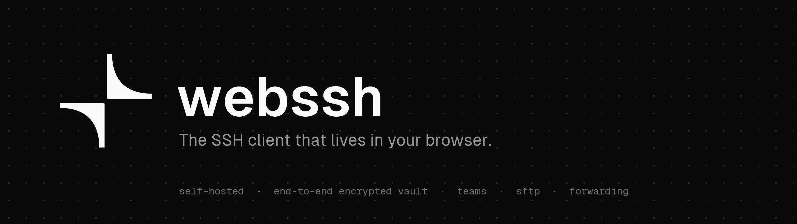
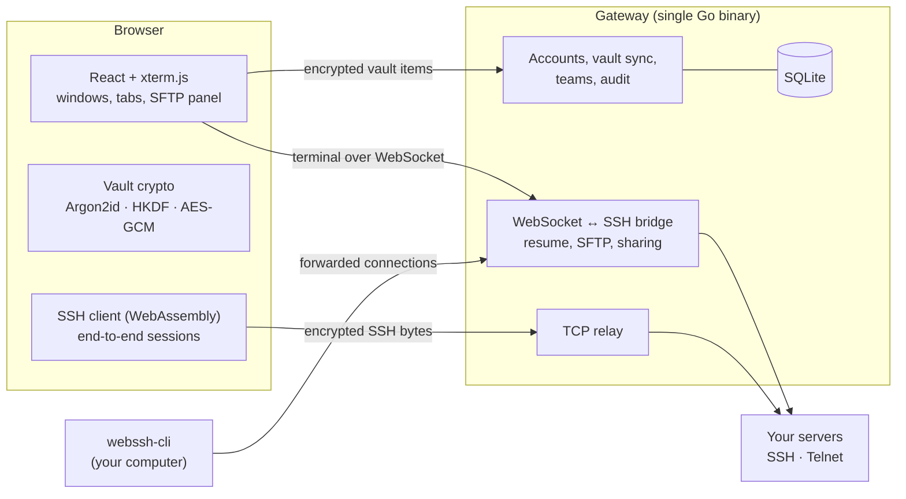

<p align="center">
  
</p>

<p align="center">
  <a href="#quick-start"><b>Quick start</b></a> ·
  <a href="#features"><b>Features</b></a> ·
  <a href="#security-model"><b>Security</b></a> ·
  <a href="#architecture"><b>Architecture</b></a> ·
  <a href="docs/PLAN.md"><b>Roadmap</b></a>
</p>

<p align="center">
  
  
  
  
  
  <a href="LICENSE"></a>
</p>

**webssh** is a self-hosted SSH client you use from any browser. A single Go binary serves the app and bridges your browser to your servers. Your hosts, keys, passwords and snippets live in a vault that is encrypted in the browser before it is ever synced, so the server stores only ciphertext.

- **Nothing to install.** Open a tab on your laptop, a borrowed machine or your phone, unlock your vault, and connect.
- **Yours to run.** One binary (or one Docker command) on your own server. No accounts with anyone else, no telemetry.
- **Built for teams.** Shared, end-to-end encrypted vaults, roles, live session sharing, and an audit log for the admin.

---

## Features

### Terminal and workspace
- **Windows or tabs.** Drag, resize, snap, minimize and maximize sessions like desktop windows, split a window right or down, or switch to tabs. Phones always use tabs, with an extra-keys bar (Esc, Tab, Ctrl, Alt, arrows).
- **Command palette** (`Ctrl+Shift+K`) to connect, switch sessions, run snippets and change settings.
- **Command suggestions** from your history and snippets as you type; `Ctrl+Space` accepts. History is kept in your encrypted vault.
- **Broadcast input** to every open session, **find in terminal**, snippets with run-on-connect, session **recording** (asciicast) with a built-in player, light and dark themes, and an installable app (PWA).
- **Session resume.** If your Wi-Fi drops or your laptop sleeps, the session keeps running for 5 minutes and reattaches on its own, replaying what you missed.

### Connections
- **SSH** with password, private key, or keychain identities; **jump hosts** (ProxyJump, up to 4 hops); opt-in **agent forwarding**.
- **Host keys** are trusted on first use and synced through the vault. A changed key is blocked, with the old and new fingerprints shown side by side.
- **Telnet** for switches, routers and lab gear.
- **Import `~/.ssh/config`**, host groups, and colour tags.

### Files and forwarding
- **SFTP panel** beside each terminal, on the same connection: browse, drag-and-drop upload with progress, download, rename, delete, chmod, and edit text files in place.
- **Port forwarding in the browser** for web apps on the server (dashboards, dev servers), each on its own origin.
- **Local, SOCKS and remote forwarding** (like `ssh -L`, `-D`, `-R`) through the [companion CLI](#companion-cli), for databases and anything else that isn't a web page.

### Security and privacy
- **Zero-knowledge vault.** Your master password never leaves the browser; everything in the vault is encrypted with AES-256-GCM before syncing.
- **End-to-end sessions.** Optionally run the SSH client itself in your browser (WebAssembly), so the gateway only relays encrypted bytes and never sees your password, key or terminal.
- **Two-factor sign-in** (TOTP), a one-time **recovery code**, auto-lock, and an **activity log** that records connections but never terminal contents.

### Teams
- **Shared vaults** with roles (owner, admin, member, viewer). Share a host and its key, jump hosts, snippet and trusted host key come along.
- **Members are confirmed by key fingerprint**, so a compromised server can't slip in its own key. Removing a member **rotates the team key** automatically.
- **Live session sharing**: send a link so a teammate can watch your terminal, or work in it with you.
- **Gateway admin**: invitations, a require-2FA policy, and a CSV-exportable audit log for every account.

### Optional AI helper
Off by default. When the admin enables it, you can **explain selected terminal output** or **describe a command in words** and get one back to review. Only the text you choose is sent to Claude (Anthropic), and suggested commands are typed in for you to check, never run.

---

## Quick start

### With Docker (recommended)

Point a DNS record at your server, then:

```bash
WEBSSH_DOMAIN=ssh.example.com docker compose -f deploy/docker-compose.yml up -d --build
```

Caddy obtains a TLS certificate automatically. **Open `https://ssh.example.com` straight away and create your account:** the first account becomes the gateway admin, and sign-up closes after it.

### On Dokploy

1. **Create an Application** from this repository (branch `main`).
2. **Build:** type *Dockerfile*, Dockerfile path `deploy/Dockerfile`, build context `.`.
3. **Environment:** `WEBSSH_FORWARD_PORTS=off` (Dokploy's proxy only routes the main port; the companion CLI still forwards). Add `WEBSSH_ALLOW_PRIVATE=true` if you'll connect to machines on your private network.
4. **Volume:** a named volume mounted at `/data` (the database and `server.key` live there).
5. **Domain:** your hostname, container port `7022`, HTTPS on.
6. **Deploy**, then open the domain and create your account straight away.

### From source

Requires **Go 1.26+** and **Node 20+**.

```bash
npm --prefix apps/web install
```

```bash
npm run build
```

```bash
./bin/webssh
```

Open <http://127.0.0.1:7022> and create your account. `npm run build` produces `bin/webssh` (the gateway, with the web app embedded) and `bin/webssh-cli` (the companion CLI). Data is stored in `./data` (an SQLite database and `server.key`); back up both.

---

## Companion CLI

Browsers can't open ports on your computer, so `webssh-cli` does it for you, through a session you already have open in webssh.

1. In a session window, open **⋯ → Forward a port** and pick **Local port**, **SOCKS** or **Remote**.
2. Run the command webssh shows you, for example:

```bash
WEBSSH_TOKEN=… webssh-cli forward -gateway https://ssh.example.com
```

| Kind | Like | What it does |
|---|---|---|
| Local port | `ssh -L` | A service on the server's side (PostgreSQL, Redis…) appears on a port of your computer. |
| SOCKS | `ssh -D` | A SOCKS5 proxy on `127.0.0.1:1080`; apps that use it reach anything the server can. |
| Remote | `ssh -R` | The server listens on a port; its connections arrive at a port on your computer. |

The token works for that one forward only and stops when you stop the forward or the session ends. To build the CLI for another platform, for example Apple Silicon:

```bash
GOOS=darwin GOARCH=arm64 go -C server build -o ../bin/webssh-cli-mac ./cmd/webssh-cli
```

---

## Configuration

All settings are environment variables.

| Variable | Default | Description |
|---|---|---|
| `WEBSSH_ADDR` | `127.0.0.1:7022` | Listen address. The Docker image uses `0.0.0.0:7022`. |
| `WEBSSH_DATA_DIR` | `data` | Where the SQLite database and `server.key` live. |
| `WEBSSH_OPEN_SIGNUP` | `false` | Allow sign-ups after the first (admin) account. Invitations work either way. |
| `WEBSSH_TRUST_PROXY` | `false` | Trust `X-Forwarded-For` / `-Proto` from a reverse proxy. The image sets `1`. |
| `WEBSSH_ALLOW_PRIVATE` | `true` on loopback | Allow connections to private, loopback and link-local addresses. `false` on any other bind; Compose sets `true` for homelabs. |
| `WEBSSH_MAX_SESSIONS` | `50` | Concurrent sessions on the gateway. |
| `WEBSSH_MAX_USER_SESSIONS` | `20` | Concurrent sessions per account. |
| `WEBSSH_RESUME_MINUTES` | `5` | How long a session waits for its browser to come back. `0` turns resume off. |
| `WEBSSH_FORWARD_PORTS` | `7100-7109` | Ports for in-browser port forwarding, one forward each. `off` (or empty) turns it off. |
| `WEBSSH_ALLOWED_ORIGINS` | none | Extra origins (`host:port`, comma-separated) allowed to call the API. |
| `WEBSSH_AI` | `false` | Turn on the AI helper. Also needs `ANTHROPIC_API_KEY`. |
| `WEBSSH_AI_MODEL` | `claude-opus-5-5` | Model the AI helper uses. |

---

## Architecture



- **Gateway sessions** (the default): the gateway is the SSH client, which enables resume, SFTP, port forwarding and session sharing.
- **End-to-end sessions**: the same SSH code, compiled to WebAssembly, runs in your browser; the gateway only relays the encrypted connection.
- The SSH client (`internal/sshcore`) and the file API (`internal/sftpweb`) are shared by both, so the two modes behave the same.

---

## Security model

```
master password ──Argon2id (64 MiB)──▶ master key ──HKDF──┬─▶ auth key  → server stores sha256(salt‖key) to sign you in
                                                           └─▶ wrap key  → never leaves the browser
vault key (random, 256-bit) ── wrapped by the wrap key ──▶ server
vault items ── AES-256-GCM(vault key, aad = item id) ──▶ server (opaque ciphertext)
```

- **The server never sees** your master password, vault key, saved hosts, credentials, snippets or command history. A copy of the database alone decrypts nothing.
- **In a gateway session, the gateway sees** credentials and terminal traffic while the session is open, because it is the SSH client. That's why you run it yourself. Use an **end-to-end session** when you don't want even your own gateway to see a connection.
- **Teams** use a P-256 key pair per account and a random key per team, wrapped for each member. Members are confirmed by comparing fingerprints out of band, and removing a member re-encrypts the team vault under a new key. Change any passwords the removed person could already read.

<details>
<summary><b>More detail</b></summary>

- **Sign-in:** `HttpOnly`, `SameSite=Strict` session cookies (`Secure` behind TLS); cross-origin state changes are refused; login, recovery and 2FA are rate-limited per IP and per account; unknown emails get a decoy salt, so accounts can't be enumerated.
- **Admins can't read vaults.** The gateway admin manages accounts and policy, with no way into any vault they aren't a member of.
- **Host keys** are trusted on first use and synced in the vault; a mismatch is a hard block.
- **Resume** requires a per-session token usable only by the same account. While detached, the gateway stops reading from the server instead of buffering without limit.
- **End-to-end sessions:** the gateway records destination, duration and byte counts only. The WebAssembly client is served by your own gateway, so you still trust its code; what you gain is that a compromised gateway *at runtime* sees nothing.
- **Session sharing:** links are random tokens (stored hashed) that only work for accounts on the same gateway. *Watch and type* lets others run commands as you, so share it with care; it ends when you stop it or the session closes.
- **Command history** records a line only if the server echoed it (so a password typed at a prompt isn't kept) and never one that starts with a space.
- **CLI forwards** use a hashed bearer token tied to one forward and one session. Prefer `https`; pass the token via `WEBSSH_TOKEN` to keep it out of shell history.
- **Telnet** is unencrypted between the gateway and the device; use it only on networks you trust.
- **Port forwarding** previews run on their own ports (separate origins); webssh cookies are stripped before requests reach the forwarded app.
- **Agent forwarding** keeps your key in gateway memory for the session's lifetime, so it is opt-in per host.
- **Egress:** hostnames are resolved once and that exact IP is dialed (no DNS rebinding); private ranges are blocked unless allowed.
- **AI helper:** off unless enabled; only the text you choose is sent, after you've reviewed it.
- **Browser:** strict Content-Security-Policy, self-hosted fonts, no third-party scripts; the in-memory vault key is a non-extractable WebCrypto key.

</details>

---

## Development

Run the gateway and the Vite dev server (which proxies `/api` and `/ws` to the gateway) in two terminals, then open <http://localhost:5173>:

```bash
npm run dev:server
```

```bash
npm run dev:web
```

Run the checks:

```bash
npm test
```

This runs `go vet`, the API tests, the gateway integration tests (against an in-process SSH server: auth, host keys, jump hosts, SFTP, resume, forwarding, sharing, Telnet, the end-to-end relay) and the frontend typecheck.

<details>
<summary><b>Project layout</b></summary>

```
apps/web/                 React + Vite + xterm.js frontend
  src/lib/crypto.ts       vault and team crypto (Argon2id, HKDF, AES-GCM, ECDH)
  src/lib/vault.ts        encrypted vault store and sync
server/                   Go gateway (single binary, embeds the built frontend)
  cmd/webssh/             the gateway
  cmd/webssh-cli/         companion CLI (TCP forwarding)
  cmd/webssh-wasm/        in-browser SSH client for end-to-end sessions
  internal/api/           accounts, vault, teams, admin, audit, AI endpoints
  internal/gateway/       WebSocket ↔ SSH bridge, relay, forwarding, sharing, Telnet
  internal/sshcore/       SSH client shared by the gateway and the browser
  internal/sftpweb/       file API, shared by the gateway and the browser
  internal/store/         SQLite (pure Go, no cgo)
deploy/                   Dockerfile, docker-compose with Caddy
design/                   logo, theme tokens, prototype
docs/PLAN.md              architecture notes and roadmap
```

</details>

---

## Status

webssh is under active development. Everything above is implemented and covered by tests, but it has not yet had an independent security review or been run in production. The Docker deployment has not yet been verified on a live server. See the [roadmap](docs/PLAN.md) for what's done and what's next (native desktop and mobile apps, Mosh, single sign-on, hardware security keys).

## Brand

The logo lives in [`design/logo`](design/logo): the mark as SVG (`mark.svg` uses `currentColor`; black and white versions too), the app icon, the favicon, the README banner and a GitHub social preview image. `design/logo/render.py` regenerates the PNGs.

## License

webssh is released under the [MIT License](LICENSE).
