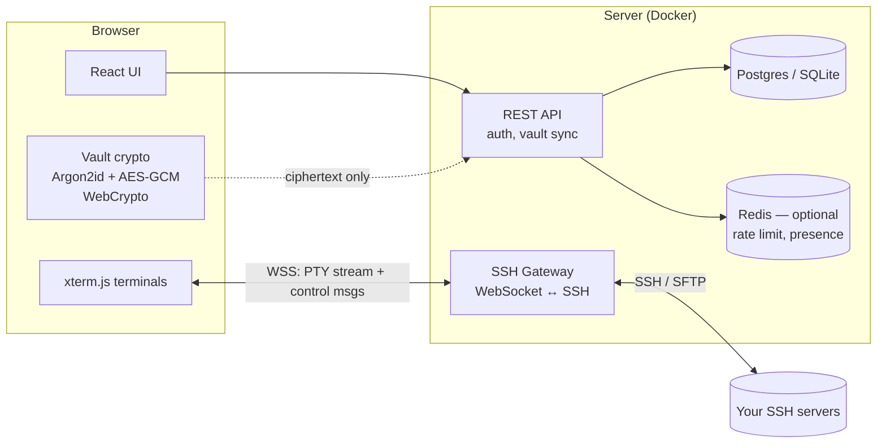

# WebSSH — Browser-Based SSH Client (Termius Alternative)

> Working name: **WebSSH** (placeholder). Avoid "Ternius" or anything close to "Termius" — it's a registered trademark and a lookalike name invites a takedown.

Status: planning · Date: 2026-10-28

---

## 1. Goal

A web app where you sign in from any browser, open your saved hosts, and get a fast, full-featured SSH terminal plus SFTP file manager — with your hosts, keys and snippets synced and encrypted so the server can't read them.

**What "Termius alternative" means here (feature parity targets):**

| Termius feature | WebSSH plan | Phase |
|---|---|---|
| Host list with groups, tags, search | Yes | 1 |
| Password + private-key auth | Yes | 1 |
| Multi-tab terminal | Yes | 1 |
| Encrypted vault synced across devices | Yes (zero-knowledge) | 1 |
| Keychain (keys, identities reused across hosts) | Yes | 2 |
| Snippets (saved commands, one-click run) | Yes | 2 |
| SFTP browser (upload / download / edit) | Yes | 2 |
| Known-hosts / host-key verification | Yes | 1 |
| Jump hosts (ProxyJump) | Yes | 2 |
| Split panes, broadcast input to many hosts | Yes | 3 |
| Port forwarding | Partial — see §7.4 (browsers can't open local ports) | 3 |
| Team vaults / sharing hosts | Yes | 4 |
| Agent forwarding | Yes, from in-vault keys | 3 |
| Mosh | No (UDP, not feasible from browser) | — |
| Native mobile apps | No — responsive PWA instead | 3 |

---

## 2. The core constraint

**Browsers cannot open raw TCP connections.** SSH runs over TCP port 22, so a pure web page cannot talk to an SSH server directly. Every web SSH client needs a **gateway** that bridges WebSocket ↔ TCP.

That leaves two architectures:

### Option A — Server-terminated SSH (gateway speaks SSH)
```
Browser (xterm.js) ──WebSocket/TLS──▶ Gateway (Go, runs SSH client) ──SSH──▶ Target host
```
- Gateway does the SSH handshake, holds decrypted credentials **in memory for the session**, streams PTY bytes to the browser.
- ✅ Simple, mature libraries (`golang.org/x/crypto/ssh`), easy SFTP, jump hosts, port forwarding, session recording.
- ❌ Gateway sees plaintext terminal traffic and the credential during the session. Trust in the gateway operator is required.

### Option B — Client-terminated SSH (browser speaks SSH, gateway is a dumb pipe)
```
Browser (SSH in WASM) ──WebSocket/TLS──▶ Relay (TCP pipe only) ──raw TCP──▶ Target host
```
- SSH runs inside the browser (WASM build of an SSH lib); relay just forwards encrypted bytes.
- ✅ True end-to-end: keys never leave the browser, relay sees only ciphertext.
- ❌ Much harder: WASM SSH libs are less mature, SFTP/agent-forwarding/jump-hosts all must be done client-side, debugging is painful.

### ✅ Recommendation
**Build Option A first, design for Option B later.**
- Keep the **vault zero-knowledge** (server stores only ciphertext; decryption in browser with your master password).
- At connect time the browser sends the needed credential to the gateway over TLS; the gateway keeps it in memory only and wipes it on disconnect. Never written to disk or logs.
- Self-hosting the gateway (one Docker container on your own VPS) removes most of the trust problem for personal use.
- Phase 5 adds an optional "E2E mode" (Option B) for paranoid users.

---

## 3. Architecture



- **One Go binary** serves the API, the gateway WebSocket, and the built frontend (embedded with `embed.FS`). Single container to deploy.
- API and gateway are separate packages so the gateway can later scale out / run in other regions (closer to targets = lower latency).

---

## 4. Tech stack

| Layer | Choice | Why |
|---|---|---|
| Frontend | React 19 + TypeScript + Vite | Fast dev, you already use React (Hook) |
| UI kit | Tailwind CSS + shadcn/ui | Clean, Termius-like dark UI quickly |
| State | Zustand + TanStack Query | Simple local state + server cache |
| Terminal | **xterm.js** (`@xterm/xterm`) + addons: `fit`, `webgl`, `search`, `web-links`, `unicode11`, `serialize` | Industry standard (VS Code uses it), GPU rendering |
| Split panes | `react-resizable-panels` | |
| Code/file editor (SFTP edit) | Monaco or CodeMirror 6 | CodeMirror is lighter |
| Vault crypto | WebCrypto (AES-256-GCM) + `hash-wasm` (Argon2id) | No custom crypto |
| Backend | **Go 1.23+** | Same as your Hook project; best-in-class SSH lib |
| SSH | `golang.org/x/crypto/ssh` + `github.com/pkg/sftp` | Mature, supports ed25519, certs, agent, jump hosts |
| HTTP / WS | `chi` router + `github.com/coder/websocket` | Small, context-aware |
| DB | Postgres (SaaS) / SQLite (self-host) via `sqlc` + `goose` migrations | Typed queries, one schema for both |
| Auth | Email + password (Argon2id), TOTP 2FA, WebAuthn/passkeys (phase 3) | |
| Deploy | Docker, docker-compose, Caddy for auto-TLS | One-command self-host |
| Tests | Go `testing` + testcontainers (real OpenSSH server), Vitest, Playwright E2E | |

---

## 5. Repository layout

```
ssh/
├── apps/
│   └── web/                     # React frontend
│       ├── src/
│       │   ├── features/
│       │   │   ├── auth/
│       │   │   ├── vault/       # crypto, unlock screen, sync
│       │   │   ├── hosts/       # list, groups, tags, editor
│       │   │   ├── keychain/    # keys & identities
│       │   │   ├── terminal/    # xterm wrapper, tabs, panes
│       │   │   ├── sftp/        # file browser
│       │   │   ├── snippets/
│       │   │   └── settings/    # themes, fonts, keybinds
│       │   ├── lib/ws-protocol.ts
│       │   └── main.tsx
│       └── vite.config.ts
├── server/
│   ├── cmd/webssh/main.go       # single binary entrypoint
│   ├── internal/
│   │   ├── api/                 # REST handlers
│   │   ├── auth/                # sessions, TOTP, passkeys
│   │   ├── vault/               # ciphertext blob storage + versioning
│   │   ├── gateway/             # WebSocket ↔ SSH bridge
│   │   │   ├── session.go
│   │   │   ├── pty.go
│   │   │   ├── sftp.go
│   │   │   ├── forward.go
│   │   │   └── egress.go        # SSRF / destination policy
│   │   ├── audit/
│   │   ├── store/               # sqlc generated
│   │   └── config/
│   ├── migrations/
│   └── web/                     # embedded frontend build
├── deploy/
│   ├── Dockerfile
│   ├── docker-compose.yml
│   └── Caddyfile
├── docs/
│   └── PLAN.md
└── Makefile
```

---

## 6. Security model (most important section)

A web SSH gateway is a **remote shell launcher on the internet**. Treat it as high-value.

### 6.1 Zero-knowledge vault
- On signup: user picks **master password** (can equal login password only if you derive two separate keys — recommended: separate).
- `masterKey = Argon2id(masterPassword, salt, m=64MB, t=3, p=1)`
- Random 256-bit **vault key** encrypts every item (AES-256-GCM, random 96-bit nonce per item). Vault key is stored wrapped with `masterKey`.
- Server stores: `{ item_id, version, ciphertext, nonce, updated_at }` — no hostnames, usernames, or keys in plaintext. (Even hostnames are private info.)
- Recovery: offer a one-time **recovery code** that also wraps the vault key. Lose both = data gone (state this clearly in UI).
- Auto-lock vault after N minutes idle; key held only in memory (never `localStorage`).

### 6.2 Credentials in transit to the gateway
- Browser decrypts the host's credential, sends it in the first WS control message over TLS.
- Gateway keeps it in a struct for the handshake, then zeroes the byte slice. Never logged, never persisted.
- Private keys with passphrases: decrypt in browser or send passphrase — prefer decrypting in the gateway only for the handshake and discarding.

### 6.3 Host-key verification (MITM protection)
- TOFU: first connect shows fingerprint (SHA256) → user accepts → stored in vault's known_hosts.
- Changed key → **hard block** with a big warning, must explicitly replace.
- Support OpenSSH certificates / `@cert-authority` later.

### 6.4 SSRF / egress control (critical for hosted version)
The gateway will connect anywhere a user says — attackers will point it at internal networks.
- Hosted/SaaS: **deny by default** `127.0.0.0/8`, `10/8`, `172.16/12`, `192.168/16`, `169.254/16` (cloud metadata!), `100.64/10`, `::1`, `fc00::/7`, `fe80::/10`.
- Resolve DNS **once**, check the IP, then dial **that IP** (prevents DNS-rebinding).
- Self-host: config flag `ALLOW_PRIVATE_TARGETS=true` (that's the point of self-hosting a homelab gateway).
- Optional per-user allowlist of ports (default: any; hosted may restrict to 22 + user-defined).

### 6.5 Web app hardening
- Session cookies: `HttpOnly`, `Secure`, `SameSite=Strict`; short-lived access + rotating refresh.
- WebSocket: check `Origin`, require a short-lived **one-time connect ticket** (issued by API, 30s TTL) — no auth tokens in the WS URL query string.
- Strict CSP (`script-src 'self'`), no third-party scripts on the app origin (XSS here = vault theft).
- TOTP 2FA from MVP; passkeys in phase 3.
- Rate limits: login, connect attempts, per-user concurrent sessions.
- Audit log (who connected where, when, duration) — **no keystroke logging by default**; session recording is opt-in per host.

### 6.6 Threats explicitly accepted (Option A)
- A compromised gateway can see live session data. Mitigation: self-host, or E2E mode (phase 5). Document this honestly.

---

## 7. Gateway design

### 7.1 WebSocket protocol
One WebSocket per terminal session. Binary frames for terminal bytes (fast path), JSON text frames for control.

```
Client → Server (JSON)
  { "t": "connect", "ticket": "...", "host": "1.2.3.4", "port": 22,
    "user": "root", "auth": { "type": "key", "key": "...", "passphrase": "..." },
    "knownHostKey": "SHA256:...", "jump": [ ... ], "cols": 120, "rows": 32,
    "term": "xterm-256color", "env": {"LANG": "en_US.UTF-8"} }
  { "t": "resize", "cols": 140, "rows": 40 }
  { "t": "hostkey-accept" }
  { "t": "ping" }

Client → Server (binary)   keystrokes / paste bytes

Server → Client (JSON)
  { "t": "hostkey", "fingerprint": "SHA256:...", "algo": "ssh-ed25519", "status": "new|match|changed" }
  { "t": "auth-prompt", "prompts": [...] }      // keyboard-interactive / 2FA on server
  { "t": "ready" }
  { "t": "exit", "code": 0, "reason": "..." }
  { "t": "error", "code": "AUTH_FAILED|TIMEOUT|BLOCKED_DEST|HOSTKEY_CHANGED", "msg": "..." }

Server → Client (binary)   PTY output
```

- Backpressure: if the browser can't keep up (e.g. `cat` a huge file), gateway pauses reading from SSH channel (bounded buffer) instead of growing memory.
- Keepalive: SSH `keepalive@openssh.com` every 30s + WS ping.
- Idle timeout configurable; max session lifetime configurable.

### 7.2 Reconnect / session resume
- Phase 1: on WS drop, auto-reconnect = new SSH session (like Termius).
- Phase 3: **session persistence** — gateway keeps the SSH session alive for N minutes after WS drop and buffers output (ring buffer, e.g. 1 MB); browser reattaches with a resume token and replays. Great for flaky mobile networks.

### 7.3 SFTP
- Separate WS (or multiplexed channel) per SFTP panel using `pkg/sftp`.
- Operations: list, stat, mkdir, rename, delete, chmod, read, write.
- Uploads: browser streams file in chunks (e.g. 256 KB) over WS → gateway writes to SFTP. Show progress, support cancel.
- Downloads: HTTP endpoint with one-time token that streams from SFTP → browser (so the browser's native download manager works for big files). Folders → zip on the fly.
- Inline edit: open text file in CodeMirror, save back.
- Drag & drop from desktop into the file panel.

### 7.4 Port forwarding (browser limitation)
A web page can't listen on your laptop's `localhost:8080`. So:
- **Remote forward (-R)**: works normally (server side).
- **Dynamic / local (-L/-D) for HTTP services**: gateway exposes the forwarded service at a private URL like `https://fwd-<random>.yourdomain/` (auth-protected, per-user). Lets you open a remote web dashboard through SSH — covers 80% of real use.
- **Raw TCP local forwards**: only via an optional tiny **companion CLI/agent** (phase 5) that runs on the user's machine and tunnels through the gateway.

### 7.5 Jump hosts
- `ssh.Dial` to bastion → `client.Dial("tcp", target)` → `ssh.NewClientConn` over that conn. Chain arbitrarily. Each hop gets its own host-key check.

### 7.6 Agent forwarding
- Gateway implements an in-memory SSH agent (`golang.org/x/crypto/ssh/agent`) holding only the keys the user chose for that session; forwarded to the remote. Off by default per host.

---

## 8. Data model

All sensitive content is inside encrypted `vault_items.ciphertext`. Plaintext tables hold only what the server must know.

```sql
users           (id, email, password_hash, totp_secret_enc, created_at, ...)
user_keys       (user_id, kdf_params, salt, wrapped_vault_key, wrapped_vault_key_recovery)
sessions        (id, user_id, refresh_hash, ua, ip, expires_at)
vault_items     (id, vault_id, type, ciphertext, nonce, version, deleted, updated_at)
                -- type ∈ host | group | identity | key | snippet | known_host | setting
vaults          (id, owner_user_id, team_id NULL, name)
teams           (id, name) ; team_members (team_id, user_id, role, wrapped_team_vault_key)
connect_tickets (id, user_id, expires_at, used)              -- or in Redis
audit_events    (id, user_id, action, dest_ip, dest_port, started_at, ended_at, bytes_in, bytes_out)
```

Decrypted item shapes (TypeScript, inside ciphertext):

```ts
type Host = {
  id: string; label: string; hostname: string; port: number;
  groupId?: string; tags: string[];
  identityId?: string;           // or inline username/password/keyId
  jumpHostIds: string[];
  agentForwarding: boolean;
  startupSnippetId?: string;
  theme?: string; fontSize?: number; color?: string;
  env?: Record<string,string>;
}
type Identity = { id: string; label: string; username: string; password?: string; keyId?: string };
type Key      = { id: string; label: string; privateKey: string; passphrase?: string; publicKey: string; type: 'ed25519'|'rsa'|'ecdsa' };
type Snippet  = { id: string; label: string; command: string; tags: string[]; runOnEnter: boolean };
type KnownHost= { hostPort: string; algo: string; fingerprint: string; addedAt: string };
```

Sync: last-write-wins per item using `version`; on conflict, keep both and flag (rare for single user). Server returns `items updated since <cursor>`.

---

## 9. REST API (sketch)

```
POST   /api/auth/signup           POST /api/auth/login        POST /api/auth/logout
POST   /api/auth/refresh          POST /api/auth/totp/setup   POST /api/auth/totp/verify
GET    /api/me/keys               (salt, kdf params, wrapped vault key)
GET    /api/vaults/:id/items?since=cursor
PUT    /api/vaults/:id/items/:itemId    (ciphertext, nonce, baseVersion)
DELETE /api/vaults/:id/items/:itemId
POST   /api/connect-ticket        → { ticket, expiresAt }
GET    /ws/terminal               (WebSocket, ticket in first message)
GET    /ws/sftp                   (WebSocket)
GET    /api/sftp/download?token=  (streamed download)
GET    /api/audit
GET    /healthz
```

---

## 10. UI / UX

Visual theme, logo and tokens: [design/THEME.md](../design/THEME.md) · clickable prototype: [design/prototype.html](../design/prototype.html)

Layout (dark by default, Termius-like but its own look):

```
┌──────────────┬────────────────────────────────────────────────┐
│ ▸ Hosts      │  [prod-api ×] [db-1 ×] [+]          ⌘K search   │
│ ▸ Keychain   ├────────────────────────────────────────────────┤
│ ▸ Snippets   │                                                │
│ ▸ SFTP       │   root@prod-api:~#                             │
│ ▸ Forwarding │                                                │
│ ▸ Settings   │                                                │
│              ├──────────────────────┬─────────────────────────┤
│ Groups       │  SFTP: /var/www      │  Snippets ▸ restart-api  │
│  • prod (4)  │  📁 html  📄 .env     │             ▸ tail logs  │
│  • homelab   │                      │                         │
└──────────────┴──────────────────────┴─────────────────────────┘
```

Must-haves:
- **Command palette** (Ctrl/⌘+K): fuzzy search hosts, snippets, actions — fastest way to connect.
- Tabs with drag-reorder, colored per host/group (red for prod).
- Split panes (horizontal/vertical) + broadcast-input toggle.
- Terminal settings: font (bundle JetBrains Mono / Fira Code / Nerd Font), size, cursor style, scrollback, themes (Dracula, Solarized, Nord, One Dark, custom), copy-on-select, right-click paste.
- Keyboard: don't let browser shortcuts eat terminal keys (Ctrl+W, Ctrl+T, Ctrl+N are captured by browsers — install as **PWA** so they work, and warn users otherwise).
- Import: `~/.ssh/config` paste/upload, Termius CSV export, PuTTY sessions, OpenSSH private keys.
- Key generator: ed25519 in-browser, copy public key / "install on host" helper.
- Mobile: responsive layout + on-screen extra key row (Esc, Tab, Ctrl, Alt, arrows, |, ~, /).

---

## 11. Phased roadmap

Estimates assume one developer working with AI assistance, part-time-ish.

### Phase 0 — Spike ✅ (2026-10-28)
- [x] Go server: WebSocket → SSH → PTY, password + private-key auth, connect form (no hardcoded host).
- [x] React page with xterm.js connected to it. Resize works. `vim`, `tmux` render correctly (`htop` untested, not installed on the test box).
- [x] Pulled forward from Phase 1: host-key TOFU + changed-key block, egress policy, Origin check, strict CSP, gateway integration tests.
- Gateway listens on `127.0.0.1:7022` (8080 clashed with another local app).
- **Exit**: you can SSH into your VPS from the browser. Verified against a local test server in WSL, not yet against a real VPS.

### Workspace ✅ (2026-10-28, pulled forward)
- [x] Multi-session window manager: drag, 8-edge resize, minimize to dock, maximize, edge snapping (top = maximize, sides = half screen), tile, cascade.
- [x] Tabs layout that you can switch to without dropping sessions; phones always use tabs.
- [x] Saved hosts sidebar (no credentials), command palette, snippets, broadcast input, find in terminal, font size, Alt+1–9.

### Phase 1 — MVP (2–3 weeks)
- [ ] Auth: signup/login, Argon2id, TOTP, sessions.
- [ ] Zero-knowledge vault: master password, unlock screen, auto-lock, recovery code.
- [ ] Hosts CRUD with groups + tags + search.
- [ ] Password + key auth (ed25519/RSA/ECDSA, passphrase keys).
- [ ] Host-key TOFU + changed-key block.
- [ ] Multi-tab terminals, themes, font settings.
- [ ] Connect tickets, Origin check, CSP, rate limits, SSRF egress policy.
- [ ] Audit log (metadata only).
- [ ] Docker image + compose + Caddy; deploy to your own VPS.
- **Exit**: you use it daily instead of Termius for basic SSH.

### Phase 2 — Power features (2–3 weeks)
- [ ] Keychain: reusable identities and keys; key generator.
- [ ] Snippets: library, run in current tab, run on connect.
- [ ] SFTP panel: browse, upload (drag & drop), download, rename, delete, chmod, inline edit.
- [ ] Jump hosts (multi-hop).
- [ ] Import `~/.ssh/config` and Termius export.
- [ ] Command palette.

### Phase 3 — Pro UX (2–3 weeks)
- [ ] Split panes + broadcast input.
- [ ] Session resume after network drop.
- [ ] Port forwarding (remote + HTTP preview URLs).
- [ ] Agent forwarding.
- [ ] PWA install, mobile extra-keys bar.
- [ ] Passkeys (WebAuthn) login.
- [ ] Opt-in session recording (asciinema format) + playback.

### Phase 4 — Teams / SaaS (3–4 weeks)
- [ ] Team vaults: per-member wrapped team key (public-key crypto — X25519 per user), roles (owner/admin/member/read-only).
- [ ] Share host groups with a team without sharing personal vault.
- [ ] Billing (Stripe), plans: Free (personal, N hosts), Pro, Team.
- [ ] Multi-region gateways (route to nearest), Redis for presence/rate limits.
- [ ] Admin: audit export, session policies (force MFA, block private targets, IP allowlists).

### Phase 5 — Advanced (open-ended)
- [ ] E2E mode: SSH in browser via WASM, gateway becomes a TCP relay only.
- [ ] Companion CLI for raw local port forwarding.
- [ ] AI helper: explain error output / suggest command (optional, off by default, never sees vault).
- [ ] Browser extension / desktop wrapper (Tauri) for true shortcut capture.

---

## 12. Testing strategy

- **Gateway integration tests**: testcontainers spin up `linuxserver/openssh-server` (and a bastion + target pair for jump-host tests). Test password, key, passphrase key, keyboard-interactive, host-key change detection, SFTP ops, large output backpressure.
- **Egress policy tests**: table-driven — every private range blocked, DNS-rebinding attempt blocked, allowlist mode works.
- **Crypto tests**: vault encrypt/decrypt round-trip, wrong password fails, tampered ciphertext fails (GCM auth), recovery code path.
- **Frontend**: Vitest for vault/store logic; Playwright E2E: login → unlock → add host → connect → run `echo ok` → see output.
- **Terminal fidelity checklist** (manual, each release): `vim`, `htop`, `tmux`, `less`, `mc`, Unicode/emoji, 256-color + truecolor, paste of 10k lines, resize while `vim` open.
- **Security**: `govulncheck`, `npm audit`, gosec in CI; a full security review before any public launch.
- **Load**: k6 — 500 concurrent sessions against one gateway, measure memory per session (target < 1–2 MB idle).

---

## 13. Deployment

Self-host (personal):
```yaml
# deploy/docker-compose.yml (sketch)
services:
  webssh:
    image: webssh:latest
    environment:
      DATABASE_URL: sqlite:///data/webssh.db
      ALLOW_PRIVATE_TARGETS: "true"
      PUBLIC_URL: https://ssh.example.com
    volumes: [ "./data:/data" ]
  caddy:
    image: caddy:2
    ports: [ "80:80", "443:443" ]
    volumes: [ "./Caddyfile:/etc/caddy/Caddyfile", "caddy_data:/data" ]
volumes: { caddy_data: {} }
```

SaaS: Postgres, Redis, gateways as separate scalable service, egress IPs published so users can allowlist them in their firewalls (a Termius-style feature people really want).

---

## 14. Risks & open questions

| Risk | Mitigation |
|---|---|
| Gateway compromise = live session exposure | Self-host first; minimal attack surface; E2E mode later |
| SSRF into internal/cloud networks | Strict egress policy (§6.4), resolve-then-dial |
| XSS → vault key theft | Strict CSP, no 3rd-party scripts, React escaping, no `dangerouslySetInnerHTML` |
| Browser eats Ctrl+W / Ctrl+T | PWA install, document limits, remap options |
| Latency (browser → gateway → host) | Deploy gateway near your servers; multi-region later |
| Abuse (using gateway for attacks/brute force) | Per-user connect rate limits, failed-auth throttling, ToS for hosted version |
| Legal / naming | Don't use "Termius" lookalike name or copy its UI assets |

**Decisions needed from you before Phase 1:**
1. **Personal self-hosted tool first, or SaaS product from day one?** (Changes how strict egress/billing/teams work. Recommendation: personal self-host first, SaaS in Phase 4.)
2. **Separate master password from login password?** (Recommendation: yes — like Bitwarden.)
3. **Database**: SQLite for self-host + Postgres for SaaS (recommended), or Postgres only?
4. **Final product name and domain.**

---

## 15. Immediate next steps

1. Decide the 4 questions above.
2. `git init` inside this `ssh/` folder (it currently sits inside a git repo rooted at your home directory — give the project its own repo).
3. Scaffold `apps/web` (Vite + React + TS) and `server` (Go module).
4. Build the Phase 0 spike and SSH into your VPS from the browser.
